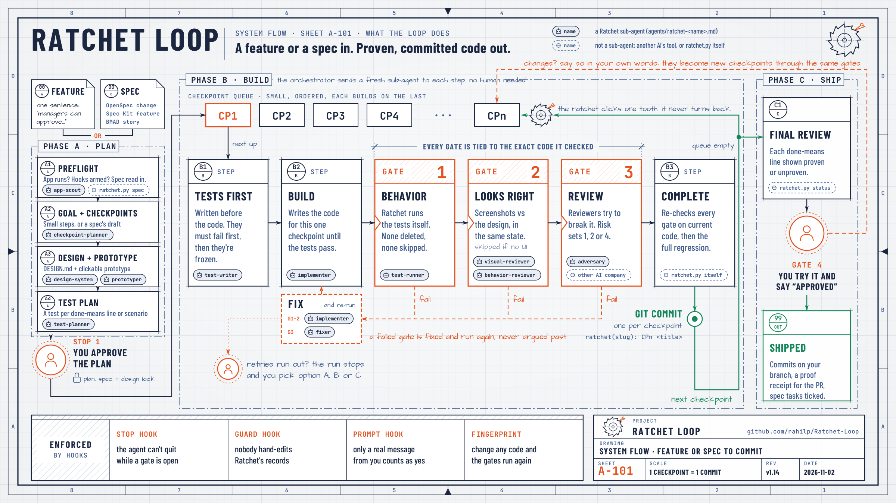

# Ratchet Loop

**AI coding agents are fast, but they'll tell you something works when it doesn't. Ratchet Loop makes them prove it.**

You describe a feature. Your agent splits it into small **checkpoints** and builds them one at a time. Each checkpoint has to get through four **gates** before the next one starts: its tests pass, it looks like the design, other reviewers try to break it and can't, and you sign off at the end. A failed gate gets fixed and run again. The agent can't argue its way past one. Like a ratchet, the work only moves forward.

You don't type any commands. You talk to your agent like normal, and it runs Ratchet for you.

<picture>
  <source media="(prefers-color-scheme: dark)" srcset="docs/images/ratchet-loop-flow-dark.png">
  
</picture>

## Install

Ratchet works in Claude Code, Codex, Gemini CLI and GitHub Copilot CLI. You install it once per computer, and then it's there in every project. Open your agent in any folder and paste this:

> Please install Ratchet Loop from https://github.com/rahilp/Ratchet-Loop and set it up for this CLI.

The agent asks before it changes anything. Part of the setup is adding Ratchet's hooks, which are what stop the agent from skipping a gate. Hooks only load when the CLI starts, so restart it when the agent asks, then say:

> Set up Ratchet and continue

That's it. The hooks stay quiet in projects that don't use Ratchet. If you use more than one of these CLIs, ask each one to install Ratchet for itself.

**You'll need** a git repository and Python 3.8 or later. For features with screens, Ratchet also uses Node 18+ and Playwright to take screenshots, and the agent offers to set those up if they're missing. For a single-project setup, OpenCode, or installing by hand, see the [reference](docs/reference.md#installing-by-hand).

## Build something

Open your agent in your project and say what you want:

> Use Ratchet to build this feature: managers can approve or reject their team's leave requests, with a reason.

Here's what happens next:

1. **Plan.** The agent checks its setup, finds which other AI tools can review the work, and reads your spec if you have one. Then it shows you a plan: the objective (who it's for, what done means, what's out of scope), the checkpoints, and at least one planned test for every "done means" line. New screens come with a clickable prototype.
2. **You approve.** Say yes, or say what to change. Once you approve, the plan, the design file and the prototype are locked.
3. **It builds, one checkpoint at a time.** For each one it writes the tests first and makes sure they fail. Then it writes code until they pass, runs the gates, and fixes whatever the gates find. Every finished checkpoint becomes its own git commit, and you get a one-line update as each lands.
4. **You try it.** The final review shows every "done means" line as proven or not, plus any small issues the reviewers noted. Say "approved", or describe what's wrong in your own words. Your changes become new checkpoints through the same gates.
5. **Ship it.** You get a proof receipt to paste into your pull request: each step, its commit, who reviewed it and what proves each line.

So you're needed twice: once for the plan and once at the end. If a gate runs out of tries, the run stops and the agent gives you a few options labelled A, B and C, with the one it recommends. Nothing gets lowered or skipped unless you pick it.

## The four gates

| | Gate | What has to be true |
|:-:|---|---|
| 1 | **Tests** | Tests written before the code fail first, then all pass. Ratchet runs them itself, and a deleted, skipped or crashed test doesn't count. |
| 2 | **Looks right** | Two reviewers compare screenshots of your app against the design or the old screen, in the same state. Skipped when there's nothing to look at. |
| 3 | **Review** | Reviewers try to break the code and find nothing blocking. A step gets one, two or four of them depending on how risky it is. |
| 4 | **You** | You try it and say yes. Only a real message from you counts. |

Reviewers come from a different AI company when you have one installed and signed in (Codex, Gemini, Claude, Copilot, Cursor, OpenCode and more), because a second company tends to catch what the first one misses. With nothing else installed, your own agent's company reviews, using a different model when it can.

### Why the agent can't cheat

| Safeguard | What it does |
|---|---|
| **Stop hook** | The agent can't end its turn while a gate is still open. |
| **Guard hook** | Nobody can hand-edit Ratchet's records or its reviews. |
| **Prompt hook** | Only a clear yes from you, to the question Ratchet asked, approves anything. |
| **Fingerprints** | Every gate result is tied to the exact code it checked. Change the code and the gates run again. |

Not every CLI can enforce all of this yet. Claude Code enforces the most, and the per-CLI table in [How it works](docs/how-it-works.md#using-it-with-codex-gemini-or-copilot) shows exactly what each one does.

## Talking to it mid-run

Say any of these at any time, in your own words:

> Where are we?

> Pause the build, and resume it when I say so.

> Give me the viewer link, and open it if you can.

> Which reviewers and providers are available on this machine?

[More things you can say](docs/guide.md#things-you-can-say-while-it-works), including how approvals work and how to accept a finding yourself.

## Already writing specs?

If your project uses **OpenSpec**, **GitHub Spec Kit** or the **BMAD Method**, Ratchet builds from your spec instead of writing its own plan:

> Use Ratchet to build the add-dark-mode change.

Every scenario gets a test that has to pass, every task is assigned to a checkpoint, and tasks get ticked off in your spec files as checkpoints pass. No spec tool? The plan you approve is the spec.

## What it adds to your project

Nothing to prepare before your first run. If something is missing, the agent creates it, and you're free to read and edit all of it.

| File | What it's for |
|---|---|
| `DESIGN.md` | Your app's look written down exactly (colours, type, spacing, component states), read from your real styles or picked with you for a new app |
| `.ratchet/standards.md` | The coding rules reviewers check against, drafted from how your code already works |
| `.ratchet/learnings.md` | Feedback that applies beyond one feature, so you never have to say it twice |
| `.ratchet/` | Ratchet's own run records and evidence |

It can also turn a repeated mistake into an automatic check, and write a GitHub Actions workflow for the mechanical checks when you ask it to set up CI.

## Questions

**How long does it take?** A small feature usually takes tens of minutes with the agent working on its own. You don't have to watch.

**Is it expensive?** It uses more AI time than letting the agent just write code, because it checks the work. Low-risk steps get one reviewer, and small nitpicks wait for the end instead of starting another round.

**Where does my code go?** Into your project, with one git commit per checkpoint. If you're on your main branch, the agent offers to start a new one first.

**Can I stop halfway?** Yes. Say "pause", and pick it up later, even in a new chat.

## Learn more

| Page | What's in it |
|---|---|
| [Using Ratchet](docs/guide.md) | A full run step by step, everything it sets up, approvals, accepting findings, specs, CI and more questions |
| [How it works](docs/how-it-works.md) | The gates in depth, screen checks, who reviews and how, choosing models, flaky tests, proof receipts, each CLI's enforcement |
| [Reference](docs/reference.md) | What's in the repo, installing by hand, every command the agent runs, and running Ratchet's own tests |
| [Security](SECURITY.md) | How to report a vulnerability |

## License

Apache 2.0. See [LICENSE](LICENSE) and [NOTICE](NOTICE).
